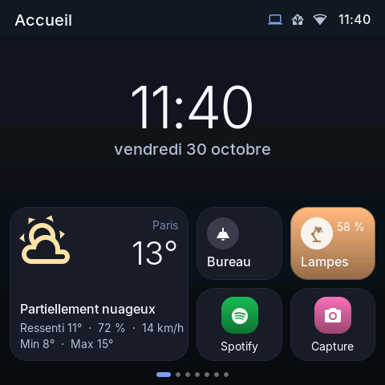
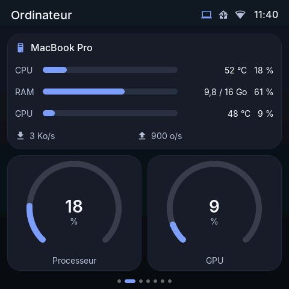
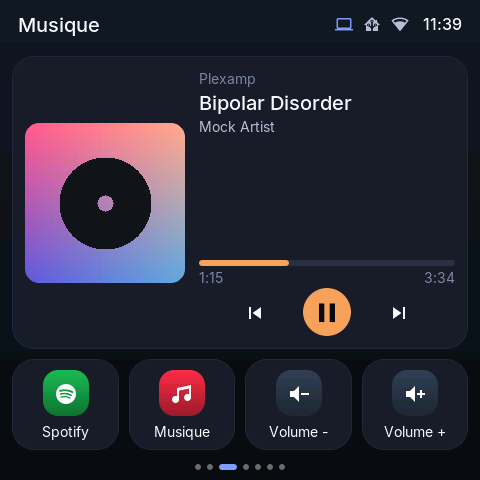
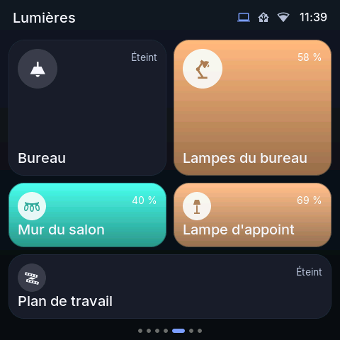
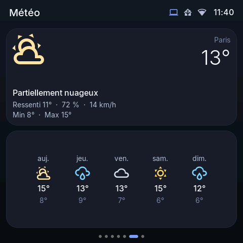
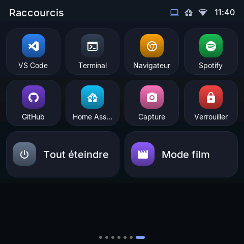

# Desk Monitor

[English](README.md) · **Français**

Écran tactile de bureau 480×480 (Guition ESP32-S3-4848S040) qui sert d'**extension de l'ordinateur**. Il fonctionne seul en Wi-Fi : Home Assistant, météo, horloge. Une application compagnon sur l'ordinateur s'y connecte par le réseau local : elle envoie les métriques du PC et la musique en cours de lecture, et exécute les raccourcis façon Stream Deck.

Les pages se configurent **à la volée** depuis un éditeur web servi par l'écran lui-même (`http://desk-monitor.local`), sans recompiler ni reflasher.

| | | |
| --- | --- | --- |
|  |  |  |
|  |  |  |

*Captures du simulateur, avec la mise en page par défaut.*

## État d'avancement

| Phase | Contenu | État |
| --- | --- | --- |
| 1 | Firmware natif (ESP-IDF + LVGL 9), thème sombre, Wi-Fi, Home Assistant, météo Open-Meteo, layout JSON, éditeur web | ✅ |
| 2 | Application compagnon (Rust/Tauri) reliée par le réseau local : métriques PC, raccourcis clavier, lancement d'applications et d'URL | ✅ macOS (Windows écrit, jamais compilé) |
| 3 | Musique en cours de lecture (toutes les apps du Mac, navigateur compris) avec pochette et commandes ; repli sur un lecteur Home Assistant | ✅ macOS (Windows à écrire) |

## Matériel

- **Guition ESP32-S3-4848S040** : dalle IPS 4" 480×480 (ST7701S, interface RGB), tactile capacitif GT911, ESP32-S3 avec 16 Mo de flash et 8 Mo de PSRAM.
- Un câble USB-C. Aucune soudure.

## Widgets

| Widget | Rôle |
| --- | --- |
| Horloge | Heure et date en français, sur le fond ou dans une carte |
| Météo | Conditions actuelles ou prévisions jusqu'à 7 jours (Open-Meteo, sans clé d'API) |
| Lumière HA | Tap pour allumer/éteindre ; **appui long** pour ouvrir la popup avec la roue chromatique, la température de blanc et la luminosité |
| Interrupteur HA | Prise, ventilateur, scène, script, volet… (le service adapté au domaine est appelé) |
| Capteur HA | Valeur et unité |
| Jauge HA | Arc à 270°, seuils orange/rouge configurables |
| Raccourci | Action Home Assistant, ou action sur le PC (raccourci clavier, application, URL) |
| Métriques PC | CPU, RAM, GPU (avec températures) et débit réseau de l'ordinateur appairé |
| Jauge PC | Une mesure du PC : CPU, RAM, GPU, mémoire GPU, disque ou température |
| Musique | Ce que joue l'ordinateur (Musique, Spotify, Chrome, Safari…) avec pochette, progression et commandes ; sinon le lecteur Home Assistant choisi |

Les widgets PC et la musique de l'ordinateur ont besoin de l'application compagnon.

### Thèmes

Le style se choisit dans l'éditeur (*Thème → Style*) :

- **Sombre opaque** (par défaut) : le plus fluide.
- **Verre figé** : cartes teintées comme du verre sur un fond coloré, presque aussi rapide.
- **Verre translucide** : le plus joli, mais environ 2,5 fois plus lent à dessiner (glissements saccadés).

## Installer depuis une release

Chaque [release](https://github.com/jboucly/desk-monitor/releases) fournit des fichiers prêts à l'emploi :

- **`desk-monitor-<version>-full.bin`** : l'image complète de l'écran. Flashe-la à l'adresse `0x0` en USB, depuis le navigateur avec [ESP Tool](https://espressif.github.io/esptool-js/), ou avec `esptool.py --chip esp32s3 write_flash 0x0 desk-monitor-<version>-full.bin`. Suis ensuite les étapes du premier démarrage ci-dessous ([Écran physique](#écran-physique)).
- **`desk-monitor-<version>-ota.bin`** : la mise à jour d'un écran qui tourne déjà sous Desk Monitor, à envoyer depuis l'éditeur (onglet *Système*). Les réglages et la mise en page sont conservés.
- **`desk-monitor-companion-<version>-macos-universal.dmg`** : l'application compagnon pour macOS 12+ (Apple Silicon et Intel). Elle n'est pas notarisée : au premier lancement, clic droit → *Ouvrir*, ou `xattr -dr com.apple.quarantine "/Applications/Desk Monitor.app"`.

Pour tout compiler soi-même, voir la suite.

## Démarrage rapide

### Prérequis

- **ESP-IDF 5.5.5** dans `~/esp/esp-idf` (ou `$DM_IDF_PATH`) : `git clone -b v5.5.5 --recursive https://github.com/espressif/esp-idf.git ~/esp/esp-idf && ~/esp/esp-idf/install.sh esp32s3`, puis `. firmware/tools/idf_env.sh` dans chaque terminal.
- **SDL2** et **libcurl** pour le simulateur : `brew install sdl2 curl`.
- **Node.js 20+** pour l'éditeur web et l'application compagnon.
- **Rust** ([rustup](https://rustup.rs)) et les outils de ligne de commande Xcode pour l'application compagnon.

### Simulateur (sans matériel)

```sh
cd web && npm install && npm run build && cd ..          # éditeur web (servi par le simulateur)
cmake -S firmware/sim -B firmware/sim/build -G Ninja    # cmake/ninja : ceux d'ESP-IDF après idf_env.sh
cmake --build firmware/sim/build
firmware/sim/build/desk_monitor_sim                      # fenêtre 480×480 + éditeur sur http://localhost:8080
```

Dans le simulateur, Home Assistant est simulé : les lumières réagissent comme dans HA. La météo, elle, est bien réelle. Le simulateur attend la vraie application compagnon sur `localhost:8081`, ou simule un PC (métriques et musique) avec `--mock-pc`.

### Écran physique

```sh
cd web && npm run build && cd ..        # l'éditeur est embarqué dans le firmware
. firmware/tools/idf_env.sh
cd firmware && idf.py build flash monitor
```

Au premier démarrage, l'écran ouvre le Wi-Fi **DeskMonitor-setup**. Connecte-toi à ce réseau, ouvre `http://192.168.4.1` puis, dans *Réglages* :

1. **Wi-Fi** : renseigne le réseau de la maison.
2. **Home Assistant** : saisis l'adresse (`http://homeassistant.local:8123`) et un jeton d'accès longue durée (Profil → Sécurité → Jetons d'accès longue durée).
3. **Météo** : cherche ta ville.

Une fois l'écran connecté, l'éditeur est accessible depuis n'importe quel navigateur du réseau : **http://desk-monitor.local**. Les mises à jour suivantes se font sans câble, depuis l'onglet *Système*, en envoyant `firmware/build/desk_monitor.bin`. Depuis un terminal : `curl --data-binary @firmware/build/desk_monitor.bin http://desk-monitor.local/api/ota`.

### Application compagnon (ordinateur)

```sh
cd companion && npm install
npm run dev                                              # lance l'app en mode développement
npm run build                                            # .app / .dmg (macOS) ou .msi (Windows) dans src-tauri/target/release/bundle/
```

Pour l'installer, glisse `Desk Monitor.app` (dans `src-tauri/target/release/bundle/macos/`) dans *Applications*, puis coche « Lancer au démarrage » dans sa fenêtre.

L'app vit dans la barre des menus. Au premier lancement, elle trouve l'écran (`desk-monitor.local`) et propose l'appairage : l'écran affiche un code à 6 chiffres à saisir dans l'app. Pour tester avec le simulateur, mets l'adresse `localhost:8081`. Le PC appairé se gère dans l'éditeur, *Réglages → Ordinateur*.

Sur macOS, l'app demande l'accès au *réseau local*, et les raccourcis clavier l'autorisation *Accessibilité* (bouton dans l'app). La musique en cours de lecture est lue avec [mediaremote-adapter](https://github.com/ungive/mediaremote-adapter), comme le fait boring.notch : aucune autorisation supplémentaire.

### Développer l'éditeur web

```sh
cd web && npm run dev                                    # API proxifiée vers le simulateur (localhost:8080)
DM_DEVICE=http://desk-monitor.local npm run dev          # … ou vers l'écran réel
```

## Structure

```
firmware/
  core/        C++ portable : bus de données, layout, thèmes, widgets, session HA, lien PC, météo, pochettes, API REST
  main/        couche ESP32 : écran ST7701S + tactile GT911, LittleFS, Wi-Fi, WebSocket HA et PC, HTTP, OTA
  bootloader_components/  rétroéclairage éteint dès le démarrage (pas de flash blanc)
  sim/         simulateur SDL2 (même code core/, HA et PC simulés, captures PNG scriptables)
  data/        layout par défaut
  tools/       génération des polices et icônes, environnement ESP-IDF
web/           éditeur (Vite + Preact + TypeScript), compilé en une page gzippée embarquée dans le firmware
companion/     application compagnon (Rust + Tauri) : métriques, raccourcis, musique en cours
  vendor/      mediaremote-adapter (lecture « À l'écoute » de macOS)
protocol/      contrats partagés : schéma du layout, liste d'icônes, API, lien PC
docs/images/   captures d'écran
```

## Crédits

- [LVGL](https://lvgl.io), [ESP-IDF](https://github.com/espressif/esp-idf) et ses composants (`esp_lcd_st7701`, `esp_lcd_touch_gt911`, `esp_lvgl_port`).
- Séquence d'initialisation de l'écran reprise du modèle `GUITION-4848S040` d'[ESPHome](https://esphome.io).
- [Tauri](https://tauri.app) pour l'application compagnon, [mediaremote-adapter](https://github.com/ungive/mediaremote-adapter) (BSD-3) pour la musique en cours sur macOS, TJpgDec (inclus dans LVGL) pour les pochettes Home Assistant.
- Police [Inter](https://rsms.me/inter/), icônes [Material Design Icons](https://pictogrammers.com/library/mdi/), météo [Open-Meteo](https://open-meteo.com).
- Licences des composants tiers : voir [THIRD_PARTY_NOTICES.md](THIRD_PARTY_NOTICES.md).

## Contribuer

Les issues et les pull requests sont les bienvenues : voir [CONTRIBUTING.md](CONTRIBUTING.md).

## Licence

[MIT](LICENSE) © Julien Boucly
