# Desk Monitor

[English](README.md) · **Français**

Écran tactile de bureau 480×480 (Guition ESP32-S3-4848S040) qui sert d'**extension de l'ordinateur**. Il fonctionne seul en Wi-Fi : Home Assistant, météo, horloge. Une application compagnon sur l'ordinateur s'y connecte par le réseau local : elle envoie les métriques du PC, la musique en cours de lecture et un tableau de bord Claude Code (sessions, sous-agents, tokens, limites du forfait ; l'écran se réveille pour autoriser un outil), et exécute les raccourcis façon Stream Deck.

Les pages se configurent **à la volée** depuis un éditeur web servi par l'écran lui-même (`http://desk-monitor.local`), sans recompiler ni reflasher.

| | | |
| --- | --- | --- |
| 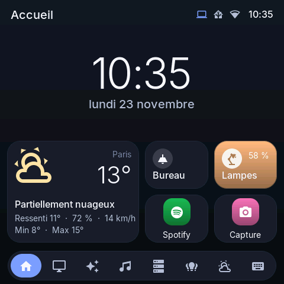 | 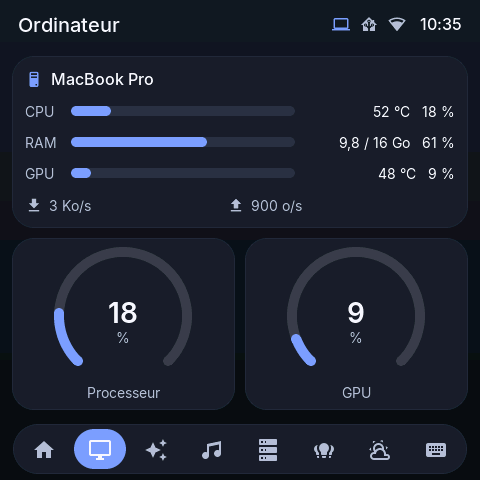 | 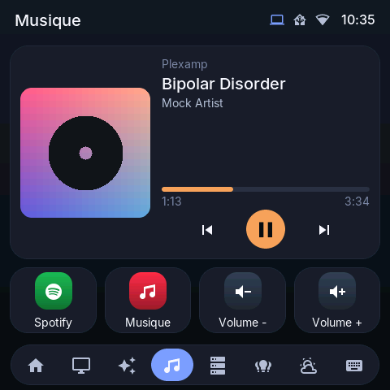 |
| 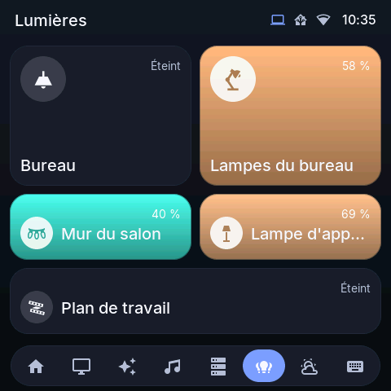 | 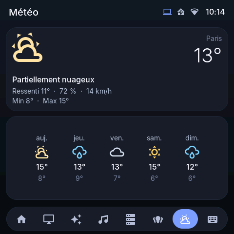 | 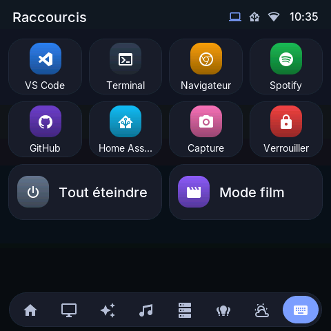 |

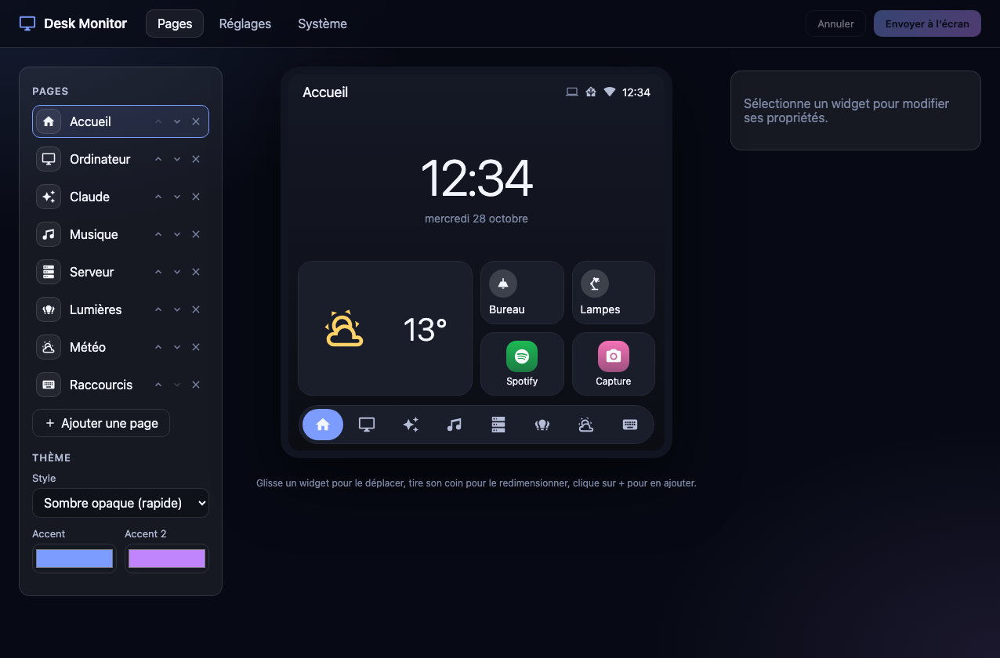
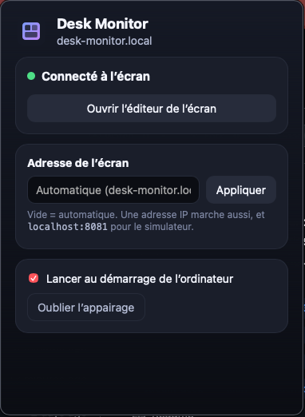

*Captures du simulateur, avec la mise en page par défaut.*

## État d'avancement

| Phase | Contenu | État |
| --- | --- | --- |
| 1 | Firmware natif (ESP-IDF + LVGL 9), thème sombre, Wi-Fi, Home Assistant, météo Open-Meteo, layout JSON, éditeur web | ✅ |
| 2 | Application compagnon (Rust/Tauri) reliée par le réseau local : métriques PC, raccourcis clavier, lancement d'applications et d'URL | ✅ macOS (Windows écrit, jamais compilé) |
| 3 | Musique en cours de lecture (toutes les apps du Mac, navigateur compris) avec pochette et commandes ; repli sur un lecteur Home Assistant | ✅ macOS (Windows à écrire) |
| 4 | Claude Code : sessions et sous-agents en cours, autorisations données depuis l'écran (qui se réveille), tokens et limites du forfait, vues détaillées en plein écran | ✅ macOS |
| 5 | Tuiles Home Assistant : thermostat, volets, curseurs, listes de choix, listes d'entités (statut des services), courbes d'historique, alarme et serrures avec clavier, règles d'affichage, templates, actions à l'appui et à l'appui long, visibilité conditionnelle | ✅ (vérifié dans le simulateur) |

## Matériel

- **Guition ESP32-S3-4848S040** ([AliExpress](https://fr.aliexpress.com/item/1005008214679682.html)) : dalle IPS 4" 480×480 (ST7701S, interface RGB), tactile capacitif GT911, ESP32-S3 avec 16 Mo de flash et 8 Mo de PSRAM.
- Un câble USB-C. Aucune soudure.
- En option : un [socle pour l'écran](https://www.printables.com/model/1740394-stand-for-the-guition-esp32s3-4848s040-4-inch) à imprimer en 3D (Printables).

## Widgets

| Widget | Rôle |
| --- | --- |
| Horloge | Heure et date en français, sur le fond ou dans une carte |
| Météo | Conditions actuelles ou prévisions jusqu'à 7 jours (Open-Meteo, sans clé d'API) |
| Lumière HA | Tap pour allumer/éteindre ; **appui long** pour ouvrir la popup avec la roue chromatique, la température de blanc et la luminosité |
| Interrupteur HA | Prise, ventilateur, scène, script, volet… (le service adapté au domaine est appelé) ; **appui long** pour ouvrir les réglages de l'entité |
| Capteur HA | Valeur et unité, ou le résultat d'un template Home Assistant ; en option, son âge (« il y a 5 min ») |
| Jauge HA | Arc à 270°, seuils orange/rouge configurables |
| Chauffage HA | Température actuelle et consigne, carte colorée quand il chauffe ou refroidit ; −/+ sur la tuile, et une popup avec un cadran de consigne, les modes, les préréglages et la ventilation. Gère aussi les chauffe-eau |
| Volet HA | Position et boutons ouvrir/stop/fermer ; une popup avec la position et l'inclinaison |
| Curseur HA | Un curseur pour un `input_number`/`number`, la luminosité d'une lumière, la vitesse d'un ventilateur, le volume d'un lecteur ou la position d'un volet |
| Liste de choix HA | Option en cours d'un `input_select`/`select` (ou préréglage d'un ventilateur) ; un appui ouvre la liste |
| Liste d'entités HA | Jusqu'à 12 entités dans une tuile : en lignes (une pièce) ou en pastilles vert/rouge avec « N en panne » (statut des services) |
| Historique HA | Courbe d'un capteur sur 1 heure à 7 jours, avec le minimum et le maximum |
| Alarme / serrure HA | État d'une alarme ou d'une serrure ; un appui ouvre les commandes, avec un clavier quand un code est demandé |
| Raccourci | Action Home Assistant, ou action sur le PC (raccourci clavier, application, URL) |
| Métriques PC | CPU, RAM, GPU (avec températures) et débit réseau de l'ordinateur appairé |
| Jauge PC | Une mesure du PC : CPU, RAM, GPU, mémoire GPU, disque ou température |
| Musique | Ce que joue l'ordinateur (Musique, Spotify, Chrome, Safari…) avec pochette, progression et commandes ; sinon le lecteur Home Assistant choisi |
| Sessions Claude | Sessions Claude Code en cours (CLI, IDE, onglet Code de l'app de bureau) : en attente, au travail ou inactives, outil utilisé, taille du contexte, sous-agents en cours. Un appui affiche la session en plein écran : tokens par type, sous-agents, derniers outils |
| Tokens Claude | Tokens du jour et de la semaine, avec un coût estimé au tarif de l'API et un histogramme sur 7 jours. Un appui affiche 30 jours par modèle, la journée heure par heure et les projets les plus gourmands |
| Limites Claude | Limites du forfait sur 5 heures et sur la semaine, avec l'heure de remise à zéro. Un appui affiche le compte à rebours, le rythme et une courbe sur 7 jours |

Les widgets PC, la musique de l'ordinateur et les widgets Claude ont besoin de l'application compagnon.

### Thèmes

Le style se choisit dans l'éditeur (*Thème → Style*) :

- **Sombre opaque** (par défaut) : le plus fluide.
- **Verre figé** : cartes teintées comme du verre sur un fond coloré, presque aussi rapide.
- **Verre translucide** : le plus joli, mais environ 2,5 fois plus lent à dessiner (glissements saccadés).

## Home Assistant

Au-delà des lumières et des interrupteurs, les tuiles Home Assistant couvrent le reste de la maison. Tout se règle dans l'éditeur ; le layout d'exemple ci-dessous montre chaque option au moins une fois.

| | | |
| --- | --- | --- |
| 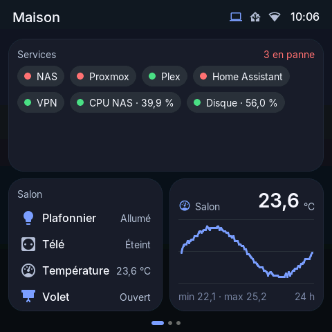 | 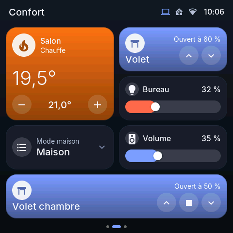 | 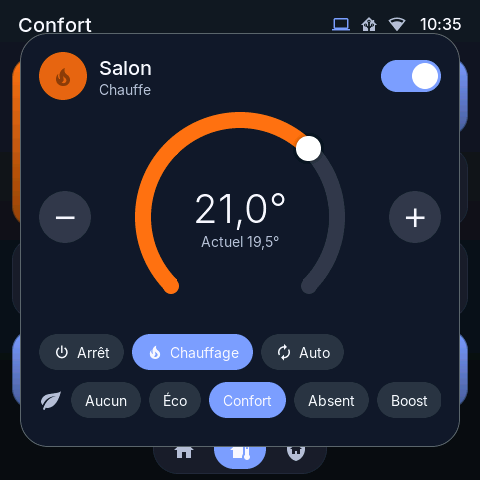 |
| 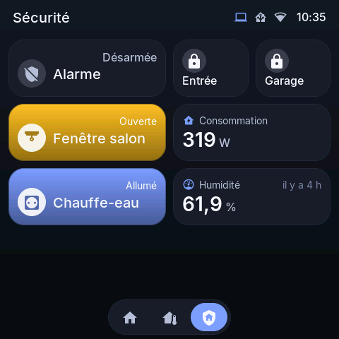 | 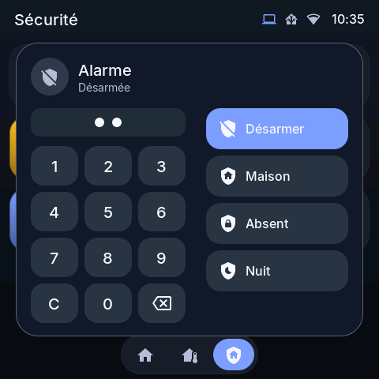 | |

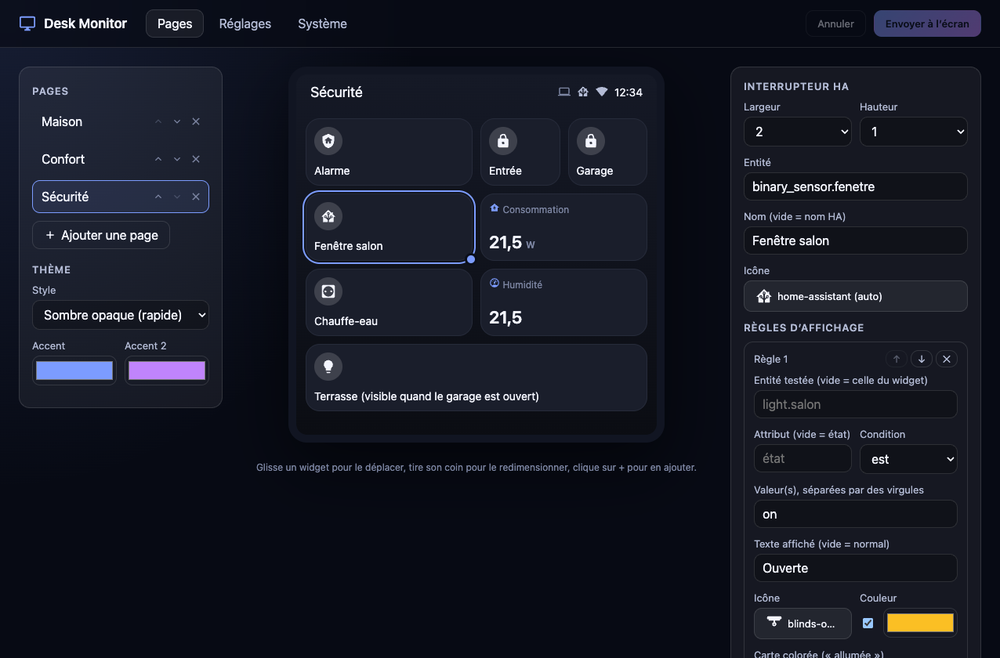

*Captures du simulateur avec [`docs/examples/home-assistant.json`](docs/examples/home-assistant.json) et des entités simulées.*

### Règles d'affichage

Chaque tuile HA peut changer ce qu'elle affiche avec des **règles** (éditeur : *Règles d'affichage*). La première règle dont la condition est vraie change le texte, l'icône, la couleur ou l'aspect « allumé » de la carte. Une condition teste l'état ou un attribut (`is`, `not`, `above`, `below`), de l'entité de la tuile ou d'une autre.

```json
"rules": [
  { "when": { "is": ["off", "unavailable"] }, "text": "Hors ligne", "icon": "server-off", "color": "#F87171" },
  { "when": { "above": 25 }, "text": "{state} °C", "color": "#FBBF24" },
  { "when": { "entity": "binary_sensor.fenetre", "is": "on" }, "text": "Fenêtre ouverte" }
]
```

Dans une liste d'entités en pastilles, la *Carte colorée* d'une règle indique si l'élément va bien (*Oui*) ou s'il est en panne (*Non*), par exemple « CPU au-dessus de 80 % → en panne ».

### Templates

Un capteur (ou un élément de liste) peut afficher un **template** Home Assistant à la place d'une entité : `{{ states('sensor.puissance') | float(0) | round(0) }}`. Home Assistant le calcule et envoie chaque changement. Le bouton *Tester* de l'éditeur le calcule une fois, avec le message d'erreur de Home Assistant s'il échoue.

### Appui et appui long

Chaque tuile HA a deux réglages, *Appui* et *Appui long* : le comportement par défaut (allumer/éteindre, ou ouvrir les réglages), allumer/éteindre ou ouvrir les réglages d'une autre entité, rien, un service Home Assistant, ou une action sur le PC (raccourci clavier, application, URL). *Demander confirmation* pose d'abord la question sur l'écran (« Couper le chauffe-eau ? »). Une serrure sans code demande toujours confirmation avant de se déverrouiller ; une alarme ou une serrure avec code ouvre un clavier.

### Visibilité

*Visible seulement si…* n'affiche une tuile que tant qu'une condition est vraie : par exemple la lumière de la terrasse seulement quand le garage est déverrouillé, ou une alerte seulement quand une fenêtre est ouverte. Sinon sa case reste vide.

### Essayer le layout d'exemple

[`docs/examples/home-assistant.json`](docs/examples/home-assistant.json) est un layout complet de trois pages (*Maison*, *Confort*, *Sécurité*). Dans le simulateur, ses entités sont simulées (le code de l'alarme et de la porte d'entrée est `1234`). Sur un vrai écran, **il remplace ton layout** : sauvegarde le tien d'abord, puis remplace les entités dans l'éditeur.

```sh
curl http://desk-monitor.local/api/layout > mon-layout.json                      # sauvegarde le layout actuel
curl -X PUT --data-binary @docs/examples/home-assistant.json http://desk-monitor.local/api/layout
curl -X PUT --data-binary @mon-layout.json http://desk-monitor.local/api/layout  # remet le tien
```

Avec un code PIN, ajoute `-H "X-DM-Pin: 1234"` aux requêtes `PUT`. Toutes les options sont décrites dans [`protocol/README.md`](protocol/README.md#layout) (en anglais).

## Claude Code

La page *Claude* suit les sessions Claude Code de l'ordinateur (terminal, extensions VS Code et JetBrains, onglet Code de l'app de bureau), grâce à l'application compagnon.

| | | |
| --- | --- | --- |
| 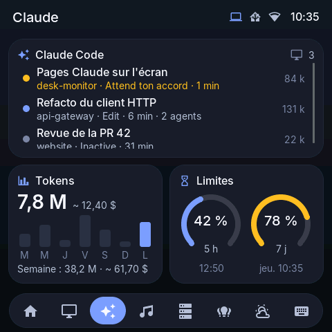 | 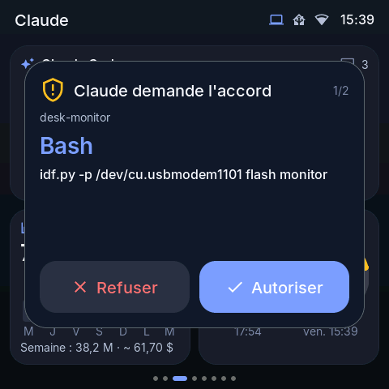 | 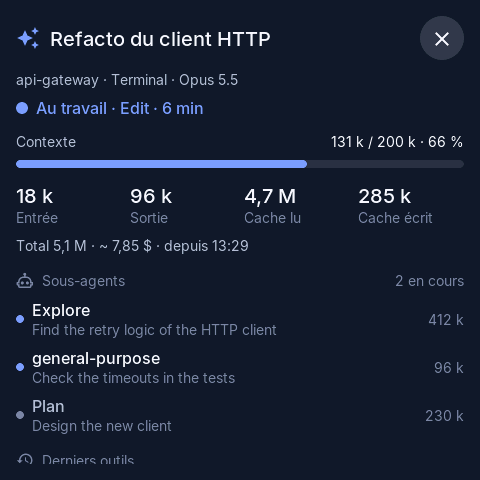 |
| 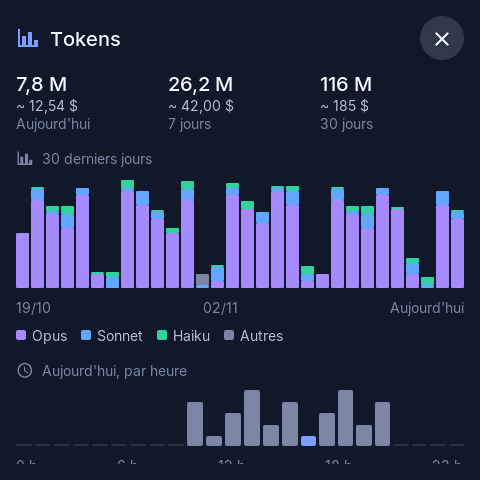 | 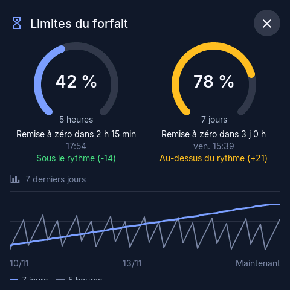 | |

- **Sessions** : en attente de toi, au travail (avec l'outil utilisé) ou inactives, la taille du contexte et les sous-agents en cours.
- **Autorisations** : quand Claude Code demande à utiliser un outil, l'écran se réveille, quelle que soit la page, et affiche *Refuser / Autoriser*. La réponse part directement à Claude Code. Fermer la popup renvoie la question au terminal ou à l'IDE, et une autorisation donnée là-bas disparaît de l'écran.
- **Détail d'une session** (appui sur une session) : modèle et environnement, fenêtre de contexte, tokens par type et coût estimé, sous-agents, derniers outils utilisés.
- **Tokens** (appui sur la carte) : aujourd'hui, 7 et 30 jours avec un coût estimé au tarif de l'API, 30 jours par modèle, la journée heure par heure, les projets les plus gourmands.
- **Limites du forfait** (appui sur la carte) : les fenêtres de 5 heures et de la semaine, le compte à rebours avant leur remise à zéro, le rythme (en avance ou en retard sur la fenêtre) et une courbe sur 7 jours.

Les conversations de claude.ai et de l'app de bureau, et les tâches Cowork, ne sont pas affichées : elles ne laissent rien de lisible sur l'ordinateur et n'ont pas de hooks. Seules les limites du forfait en tiennent compte. Voir [Application compagnon](#application-compagnon-ordinateur) pour l'installation.

## Installer depuis une release

Chaque [release](https://github.com/jboucly/desk-monitor/releases) fournit des fichiers prêts à l'emploi :

- **`desk-monitor-<version>-full.bin`** : l'image complète de l'écran. Flashe-la à l'adresse `0x0` en USB, depuis le navigateur avec [ESP Tool](https://espressif.github.io/esptool-js/), ou avec `esptool.py --chip esp32s3 write_flash 0x0 desk-monitor-<version>-full.bin`. Suis ensuite les étapes du premier démarrage ci-dessous ([Écran physique](#écran-physique)).
- **`desk-monitor-<version>-ota.bin`** : la mise à jour d'un écran qui tourne déjà sous Desk Monitor, à envoyer depuis l'éditeur (onglet *Système*). Les réglages et la mise en page sont conservés.
- **`desk-monitor-companion-<version>-macos-universal.dmg`** : l'application compagnon pour macOS 12+ (Apple Silicon et Intel). Elle n'est pas notarisée : au premier lancement, clic droit → *Ouvrir*, ou `xattr -dr com.apple.quarantine "/Applications/Desk Monitor.app"`.

Pour tout compiler soi-même, voir la suite.

## Démarrage rapide

### Prérequis

- **ESP-IDF 5.5.5** dans `~/esp/esp-idf` (ou `$DM_IDF_PATH`) : `git clone -b v5.5.5 --recursive https://github.com/espressif/esp-idf.git ~/esp/esp-idf && ~/esp/esp-idf/install.sh esp32s3`, puis `. firmware/tools/idf_env.sh` dans chaque terminal.
- **SDL2** et **libcurl** pour le simulateur : `brew install sdl2 curl`.
- **Node.js 20+** pour l'éditeur web et l'application compagnon.
- **Rust** ([rustup](https://rustup.rs)) et les outils de ligne de commande Xcode pour l'application compagnon.

### Simulateur (sans matériel)

```sh
cd web && npm install && npm run build && cd ..          # éditeur web (servi par le simulateur)
cmake -S firmware/sim -B firmware/sim/build -G Ninja    # cmake/ninja : ceux d'ESP-IDF après idf_env.sh
cmake --build firmware/sim/build
firmware/sim/build/desk_monitor_sim                      # fenêtre 480×480 + éditeur sur http://localhost:8080
```

Dans le simulateur, Home Assistant est simulé : lumières, interrupteurs, thermostats, volets, curseurs, listes de choix, l'alarme et les serrures (code `1234`) réagissent comme dans HA, les capteurs ont un historique inventé, et les templates comprennent `states()` et `state_attr()` (sans les filtres Jinja). Charge le layout d'exemple avec `curl -X PUT --data-binary @docs/examples/home-assistant.json http://localhost:8080/api/layout`. La météo, elle, est bien réelle. Le simulateur attend la vraie application compagnon sur `localhost:8081`, ou simule un PC (métriques et musique) avec `--mock-pc`.

### Écran physique

```sh
cd web && npm run build && cd ..        # l'éditeur est embarqué dans le firmware
. firmware/tools/idf_env.sh
cd firmware && idf.py build flash monitor
```

Au premier démarrage, l'écran ouvre le Wi-Fi **DeskMonitor-setup**. Connecte-toi à ce réseau, ouvre `http://192.168.4.1` puis, dans *Réglages* :

1. **Wi-Fi** : renseigne le réseau de la maison.
2. **Home Assistant** : saisis l'adresse (`http://homeassistant.local:8123`) et un jeton d'accès longue durée (Profil → Sécurité → Jetons d'accès longue durée).
3. **Météo** : cherche ta ville.

Une fois l'écran connecté, l'éditeur est accessible depuis n'importe quel navigateur du réseau : **http://desk-monitor.local**. Les mises à jour suivantes se font sans câble, depuis l'onglet *Système*, en envoyant `firmware/build/desk_monitor.bin`. Depuis un terminal : `curl --data-binary @firmware/build/desk_monitor.bin http://desk-monitor.local/api/ota`.

### Application compagnon (ordinateur)

```sh
cd companion && npm install
npm run dev                                              # lance l'app en mode développement
npm run build                                            # .app / .dmg (macOS) ou .msi (Windows) dans src-tauri/target/release/bundle/
```

Pour l'installer, glisse `Desk Monitor.app` (dans `src-tauri/target/release/bundle/macos/`) dans *Applications*, puis coche « Lancer au démarrage » dans sa fenêtre.

L'app vit dans la barre des menus. Au premier lancement, elle trouve l'écran (`desk-monitor.local`) et propose l'appairage : l'écran affiche un code à 6 chiffres à saisir dans l'app. Pour tester avec le simulateur, mets l'adresse `localhost:8081`. Le PC appairé se gère dans l'éditeur, *Réglages → Ordinateur*.

**Claude Code.** Dans l'app, coche *Sessions et autorisations sur l'écran* : elle ajoute des hooks HTTP à `~/.claude/settings.json` (tes autres réglages sont conservés, et une sauvegarde est faite). Quand Claude Code demande l'autorisation d'utiliser un outil, l'écran se réveille et affiche *Refuser / Autoriser* ; fermer la popup renvoie la question au terminal. Les limites du forfait viennent de l'app Claude de bureau, ou de la status line du terminal avec le second interrupteur (ta status line reste affichée ; elle donne aussi les heures de remise à zéro et une courbe plus fine). L'interrupteur s'applique aux nouvelles sessions Claude Code. Voir [Claude Code](#claude-code) pour ce que l'écran affiche.

Sur macOS, l'app demande l'accès au *réseau local*, et les raccourcis clavier l'autorisation *Accessibilité* (bouton dans l'app). La musique en cours de lecture est lue avec [mediaremote-adapter](https://github.com/ungive/mediaremote-adapter), comme le fait boring.notch : aucune autorisation supplémentaire.

### Développer l'éditeur web

```sh
cd web && npm run dev                                    # API proxifiée vers le simulateur (localhost:8080)
DM_DEVICE=http://desk-monitor.local npm run dev          # … ou vers l'écran réel
```

## Structure

```
firmware/
  core/        C++ portable : bus de données, layout, thèmes, widgets, session HA, lien PC, météo, pochettes, API REST
  main/        couche ESP32 : écran ST7701S + tactile GT911, LittleFS, Wi-Fi, WebSocket HA et PC, HTTP, OTA
  bootloader_components/  rétroéclairage éteint dès le démarrage (pas de flash blanc)
  sim/         simulateur SDL2 (même code core/, HA et PC simulés, captures PNG scriptables)
  data/        layout par défaut
  tools/       génération des polices et icônes, environnement ESP-IDF
web/           éditeur (Vite + Preact + TypeScript), compilé en une page gzippée embarquée dans le firmware
companion/     application compagnon (Rust + Tauri) : métriques, raccourcis, musique en cours, Claude Code
  vendor/      mediaremote-adapter (lecture « À l'écoute » de macOS)
protocol/      contrats partagés : schéma du layout, liste d'icônes, API, lien PC
docs/images/   captures d'écran
docs/examples/ layout d'exemple (tuiles Home Assistant)
```

## Crédits

- [LVGL](https://lvgl.io), [ESP-IDF](https://github.com/espressif/esp-idf) et ses composants (`esp_lcd_st7701`, `esp_lcd_touch_gt911`, `esp_lvgl_port`).
- Séquence d'initialisation de l'écran reprise du modèle `GUITION-4848S040` d'[ESPHome](https://esphome.io).
- [Tauri](https://tauri.app) pour l'application compagnon, [mediaremote-adapter](https://github.com/ungive/mediaremote-adapter) (BSD-3) pour la musique en cours sur macOS, TJpgDec (inclus dans LVGL) pour les pochettes Home Assistant.
- Police [Inter](https://rsms.me/inter/), icônes [Material Design Icons](https://pictogrammers.com/library/mdi/), météo [Open-Meteo](https://open-meteo.com).
- Licences des composants tiers : voir [THIRD_PARTY_NOTICES.md](THIRD_PARTY_NOTICES.md).

## Contribuer

Les issues et les pull requests sont les bienvenues : voir [CONTRIBUTING.md](CONTRIBUTING.md).

## Licence

[MIT](LICENSE) © Julien Boucly
