# Desk Monitor

**English** · [Français](README.fr.md)

A 480×480 desk touch screen (Guition ESP32-S3-4848S040) that acts as an **extension of your computer**. It works on its own over Wi-Fi: Home Assistant, weather, clock, and your 3D printer. A companion app on the computer connects to it over the local network: it sends PC metrics, the music currently playing and a Claude Code dashboard (sessions, subagents, tokens, plan limits; the screen wakes up to approve a tool call), and runs Stream Deck-style shortcuts.

Pages are configured **on the fly** from a web editor served by the screen itself (`http://desk-monitor.local`), with no rebuild and no reflash. A dock at the bottom of the screen jumps straight to any page (each page picks its icon in the editor); swiping still works.

> The on-screen UI and the web editor are in French.

| | | |
| --- | --- | --- |
| 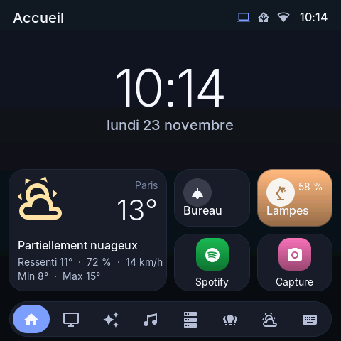 | 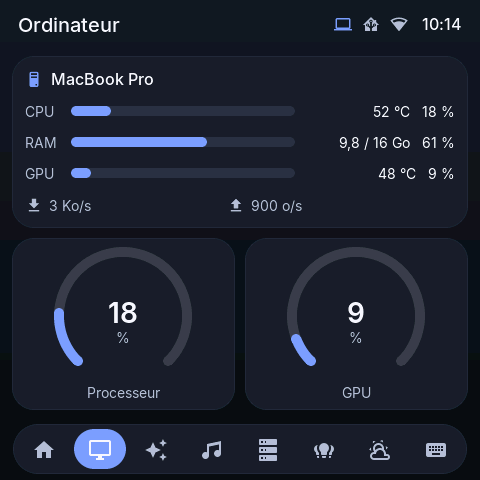 | 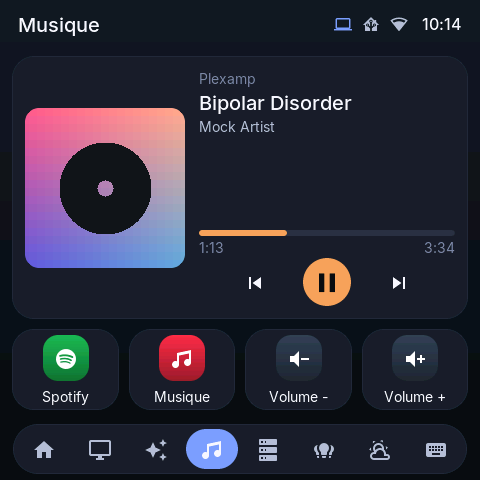 |
| 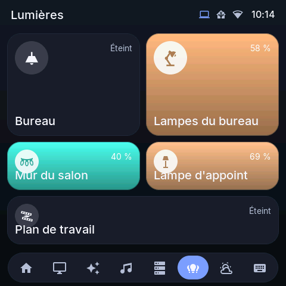 | 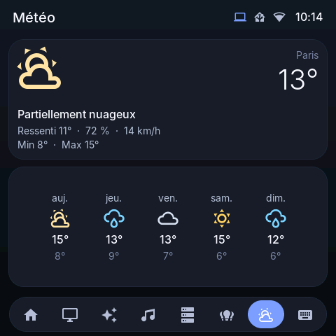 | 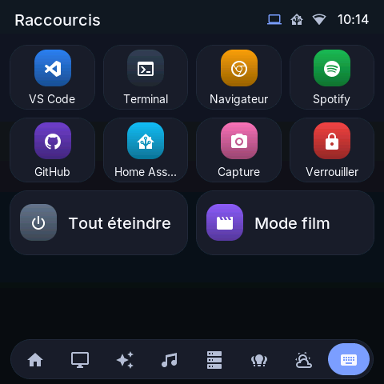 |

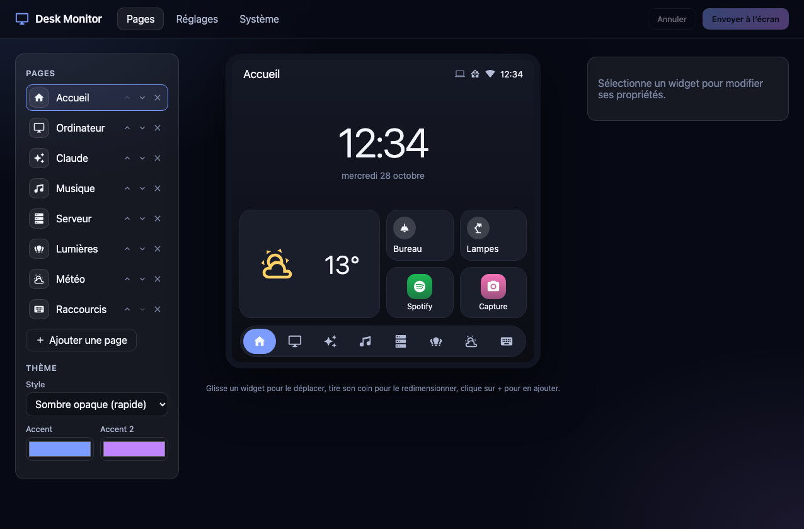
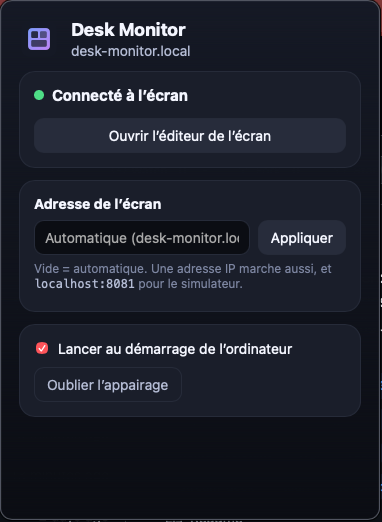


*Simulator screenshots, default layout.*

## Status

| Phase | Content | Status |
| --- | --- | --- |
| 1 | Native firmware (ESP-IDF + LVGL 9), dark theme, Wi-Fi, Home Assistant, Open-Meteo weather, JSON layout, web editor | ✅ |
| 2 | Companion app (Rust/Tauri) linked over the local network: PC metrics, keyboard shortcuts, launching apps and URLs | ✅ macOS (Windows written, never compiled) |
| 3 | Now playing (every Mac app, browsers included) with cover art and controls; falls back to a Home Assistant media player | ✅ macOS (Windows still to write) |
| 4 | Claude Code: running sessions and subagents, approvals answered from the screen (it wakes up), tokens and plan limits, full-screen detail views | ✅ macOS |
| 5 | Home Assistant tiles: thermostat, covers, sliders, choice lists, entity lists (service status), history curves, alarm and locks with a keypad, display rules, templates, tap/long press actions, conditional visibility | ✅ (checked in the simulator) |
| 6 | 3D printers: state, progress, temperatures, pause/resume/stop, last printed files started again from the screen, bed calibration on or off | 🚧 Creality stock firmware (tested on a CR-10 SE); other brands to come |

## Hardware

- **Guition ESP32-S3-4848S040** ([AliExpress](https://www.aliexpress.com/item/1005008214679682.html)): 4" 480×480 IPS panel (ST7701S, RGB interface), GT911 capacitive touch, ESP32-S3 with 16 MB flash and 8 MB PSRAM.
- A USB-C cable. Nothing to solder.
- Optional: a 3D printed [stand for the screen](https://www.printables.com/model/1740394-stand-for-the-guition-esp32s3-4848s040-4-inch) (Printables).

## Widgets

| Widget | What it does |
| --- | --- |
| Clock | Time and date, on the background or in a card |
| Weather | Current conditions or a forecast of up to 7 days (Open-Meteo, no API key) |
| HA light | Tap to toggle; **long press** opens a popup with a color wheel, white temperature and brightness |
| HA switch | Plug, fan, scene, script, cover… (the service matching the domain is called); **long press** opens the entity's controls |
| HA sensor | Value and unit, or the result of a Home Assistant template; optionally its age ("il y a 5 min") |
| HA gauge | 270° arc, configurable orange/red thresholds |
| HA thermostat | Current and target temperature, colored while heating or cooling; −/+ on the tile, and a popup with a target dial, modes, presets and fan modes. Also water heaters |
| HA cover | Position and open/stop/close buttons; a popup with position and tilt |
| HA slider | A slider for an `input_number`/`number`, a light's brightness, a fan's speed, a player's volume or a cover's position |
| HA choice list | Current option of an `input_select`/`select` (or a fan preset); a tap opens the list |
| HA entity list | Up to 12 entities in one tile: rows (a room) or green/red badges with a "N en panne" count (service status) |
| HA history | Curve of a sensor over 1 hour to 7 days, with min and max |
| HA alarm / lock | Alarm panel or lock state; a tap opens the commands, with a code keypad when needed |
| Shortcut | Home Assistant action, or an action on the PC (keyboard shortcut, app, URL) |
| PC metrics | CPU, RAM, GPU (with temperatures) and network throughput of the paired computer |
| PC gauge | One PC measure: CPU, RAM, GPU, GPU memory, disk or temperature |
| Music | What the computer plays (Music, Spotify, Chrome, Safari…) with cover art, progress and controls; otherwise the chosen Home Assistant player |
| Claude sessions | Running Claude Code sessions (CLI, IDE, desktop app's Code tab): waiting, working or idle, tool in use, context size, running subagents. A tap shows the session in full screen: tokens by kind, subagents, last tools |
| Claude tokens | Tokens of the day and of the week, with an estimated cost at API prices and a 7-day histogram. A tap shows 30 days by model, today by hour and the busiest projects |
| Claude limits | The plan's 5-hour and weekly limits, with their reset time. A tap shows the countdown, the pace and a 7-day curve |
| 3D printer | Thumbnail, file, progress, time left and end time, nozzle and bed temperatures. A tap opens the controls and the last printed files |

The PC widgets, the computer's music and the Claude widgets need the companion app.

### Themes

The style is picked in the editor (*Thème → Style*):

- **Flat dark** (default): the smoothest.
- **Frozen glass**: cards tinted like glass over a colored background, almost as fast.
- **Translucent glass**: the prettiest, but about 2.5 times slower to draw (choppy swipes).

## Home Assistant

Beyond lights and switches, the Home Assistant tiles cover the rest of the house. Every tile is set up in the editor; the example layout below shows each option at least once.

| | | |
| --- | --- | --- |
| 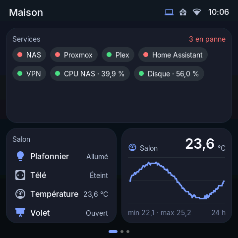 | 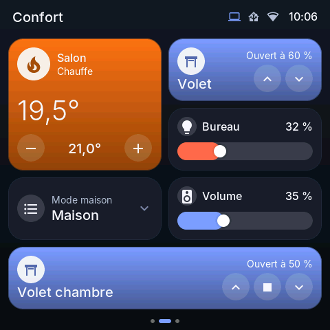 | 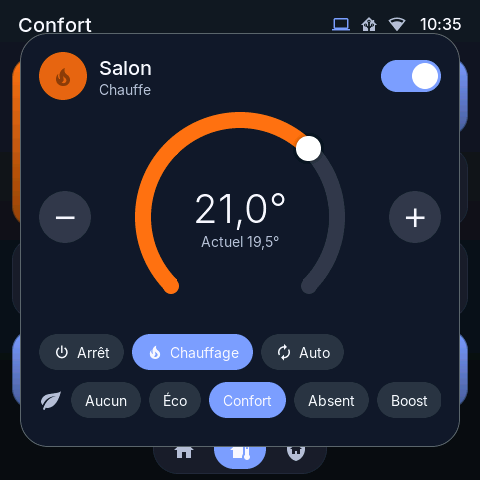 |
| 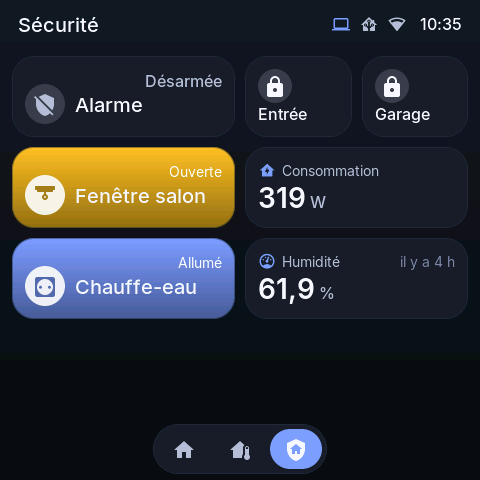 | 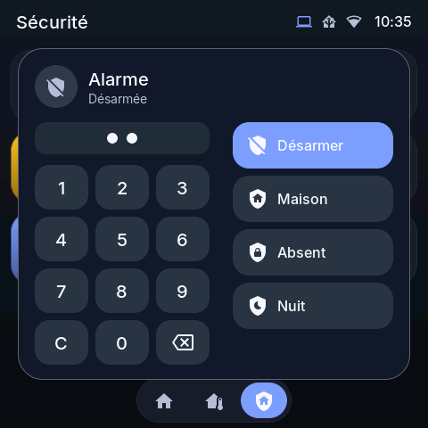 | |

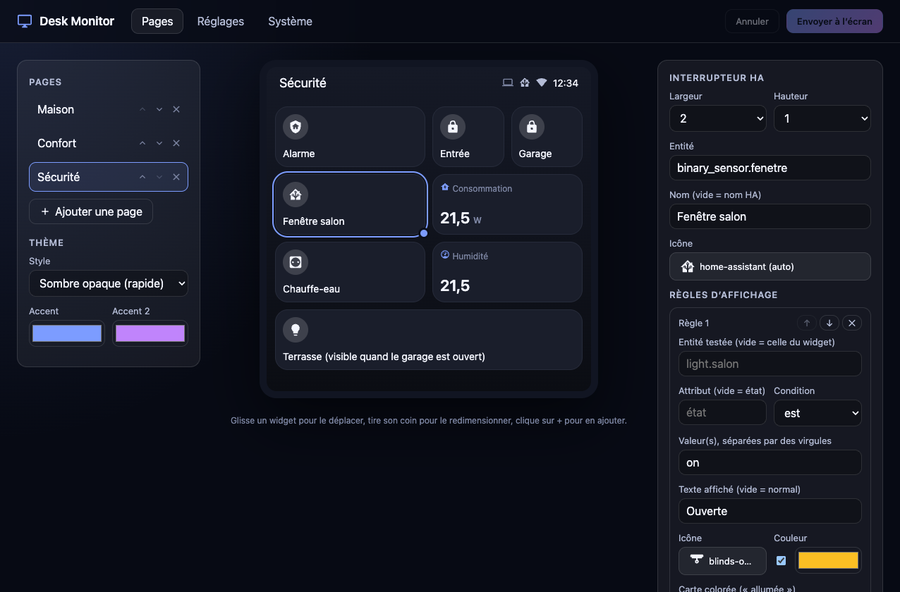

*Simulator screenshots of [`docs/examples/home-assistant.json`](docs/examples/home-assistant.json), with simulated entities.*

### Display rules

Any HA tile can change what it shows with **rules** (editor: *Règles d'affichage*). The first rule whose condition matches changes the text, the icon, the color or the colored "on" look. A condition tests the state or an attribute (`is`, `not`, `above`, `below`), of the tile's entity or of another one.

```json
"rules": [
  { "when": { "is": ["off", "unavailable"] }, "text": "Hors ligne", "icon": "server-off", "color": "#F87171" },
  { "when": { "above": 25 }, "text": "{state} °C", "color": "#FBBF24" },
  { "when": { "entity": "binary_sensor.fenetre", "is": "on" }, "text": "Fenêtre ouverte" }
]
```

In an entity list shown as badges, a rule's *Carte colorée* says whether the item is fine (*Oui*) or a problem (*Non*), e.g. "CPU above 80 % → problem".

### Templates

A sensor (or an item of a list) can show a Home Assistant **template** instead of an entity: `{{ states('sensor.power') | float(0) | round(0) }}`. Home Assistant renders it and sends every change. The *Tester* button of the editor renders it once, with Home Assistant's error message when it fails.

### Tap and long press

Each HA tile has two settings, *Appui* and *Appui long*: the default (toggle, or open the controls), toggle or open the controls of another entity, nothing, a Home Assistant service, or a PC action (keyboard shortcut, app, URL). *Demander confirmation* asks on the screen first ("Couper le chauffe-eau ?"). A lock without code always asks before unlocking; an alarm or a lock with a code opens a keypad.

### Visibility

*Visible seulement si…* shows a tile only while a condition holds, e.g. a terrace light only while the garage is unlocked, or a warning only while a window is open. Its cell stays empty otherwise.

### Trying the example layout

[`docs/examples/home-assistant.json`](docs/examples/home-assistant.json) is a complete layout with three pages (*Maison*, *Confort*, *Sécurité*). In the simulator, its entities are simulated (the alarm and the front door code is `1234`). On a real screen, **it replaces your layout**, so save yours first, then replace the entity ids in the editor:

```sh
curl http://desk-monitor.local/api/layout > my-layout.json                       # save the current layout
curl -X PUT --data-binary @docs/examples/home-assistant.json http://desk-monitor.local/api/layout
curl -X PUT --data-binary @my-layout.json http://desk-monitor.local/api/layout   # put yours back
```

With a PIN, add `-H "X-DM-Pin: 1234"` to the `PUT` requests. Every option is described in [`protocol/README.md`](protocol/README.md#layout).

## Claude Code

The *Claude* page follows the Claude Code sessions of the computer (terminal, VS Code and JetBrains extensions, the desktop app's Code tab), through the companion app.

| | | |
| --- | --- | --- |
| 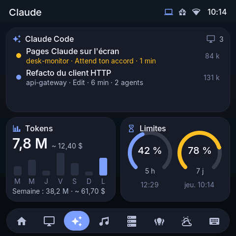 | 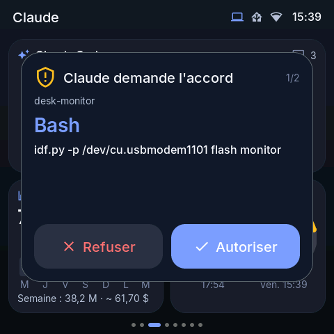 | 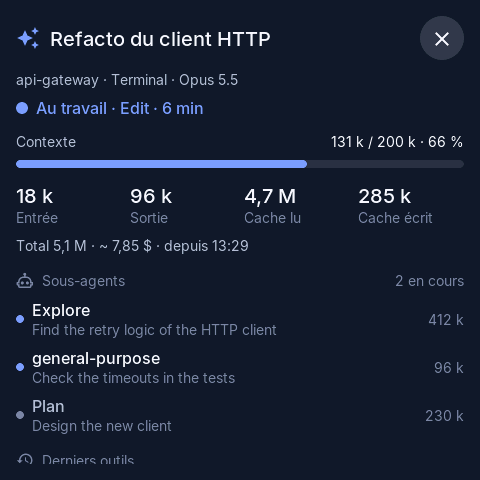 |
| 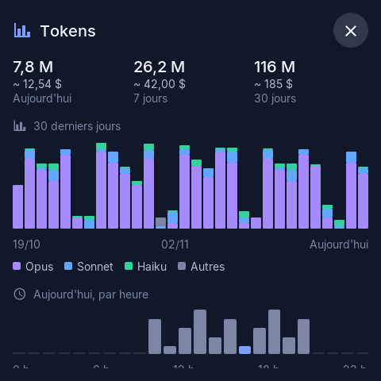 | 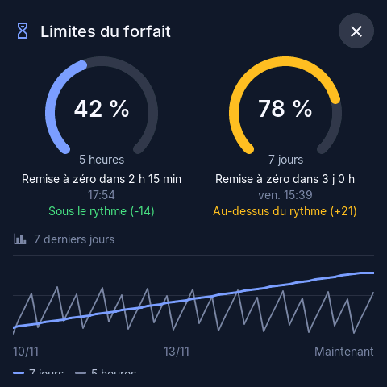 | |

- **Sessions**: waiting for you, working (with the tool in use) or idle, the context size and the running subagents.
- **Approvals**: when Claude Code asks to run a tool, the screen wakes up, whatever the page, and shows *Refuser / Autoriser*. The answer goes straight to Claude Code. Closing the popup sends the question back to the terminal or the IDE, and an approval answered there leaves the screen.
- **Session detail** (tap a session): model and surface, context window, tokens by kind and estimated cost, subagents, last tool calls.
- **Tokens** (tap the card): today, 7 and 30 days with an estimated cost at API prices, 30 days by model, today hour by hour, the busiest projects.
- **Plan limits** (tap the card): the 5-hour and weekly windows, the countdown to their reset, the pace (ahead of or behind the window) and a 7-day curve.

Chats on claude.ai and in the desktop app, and Cowork tasks, are not shown: they keep nothing readable on the computer and have no hooks. Only the plan limits count them. See [Companion app](#companion-app-computer) to set it up.

## 3D printer

The screen follows a 3D printer of the local network by itself, without the computer. Choose the model and enter its IP address in the editor (*Réglages → Imprimante 3D*), then add the *Imprimante 3D* tile to a page.

| | | |
| --- | --- | --- |
| 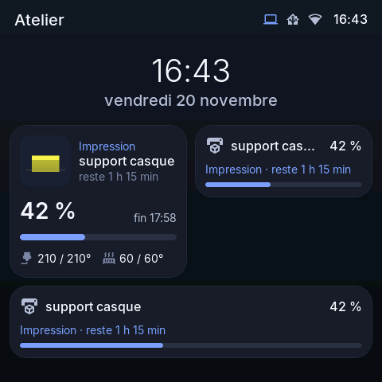 | 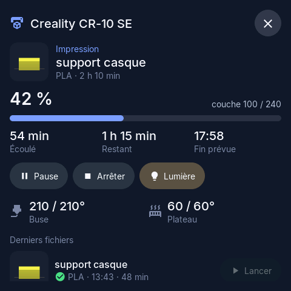 | 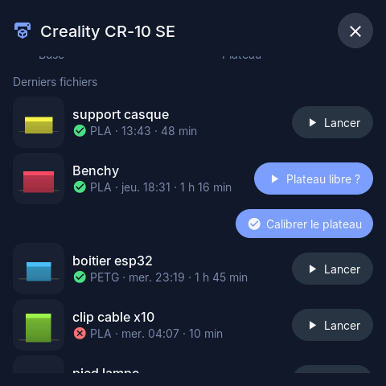 |

- **Tile**: the file's thumbnail and name, the progress, the time left and the end time, the nozzle and bed temperatures. It shows *Préparation* while the printer heats up and calibrates.
- **Full-screen view** (tap the tile): pause and resume, stop (a second tap confirms), the light, the temperatures and their targets.
- **Last printed files**, with their thumbnail, material, date, duration and result: *Lancer* prints one again. A second tap confirms that the bed is clear, and a chip chooses whether the printer calibrates its bed first.
- A toast tells when a print ends, stops or fails.

| Printers | Connection | Status |
| --- | --- | --- |
| Creality with the stock firmware: CR-10 SE, K1, K1C, K1 Max, K1 SE, Ender-3 V3 KE | Local WebSocket (port 9999), no root, no account | CR-10 SE tested, the others untested |

Give the printer a fixed address in your router (DHCP reservation): the screen does not look for it again when it changes. Other brands (Klipper/Moonraker, OctoPrint, PrusaLink, Bambu Lab) need their own driver; the models are listed in `protocol/printers.json` and the protocol is described in [protocol/README.md](protocol/README.md#3d-printer).

## Install from a release

Each [release](https://github.com/jboucly/desk-monitor/releases) ships ready-made files:

- **`desk-monitor-<version>-full.bin`**: the full screen image. Flash it at address `0x0` over USB, from the browser with [ESP Tool](https://espressif.github.io/esptool-js/), or with `esptool.py --chip esp32s3 write_flash 0x0 desk-monitor-<version>-full.bin`. Then follow the first boot steps below ([Real screen](#real-screen)).
- **`desk-monitor-<version>-ota.bin`**: the update for a screen that already runs Desk Monitor, sent from the editor (*Système* tab). Settings and layout are kept.
- **`desk-monitor-companion-<version>-macos-universal.dmg`**: the companion app for macOS 12+ (Apple Silicon and Intel). It is not notarized: on first launch, right click → *Open*, or run `xattr -dr com.apple.quarantine "/Applications/Desk Monitor.app"`.

To build everything yourself instead, see below.

## Quick start

### Requirements

- **ESP-IDF 5.5.5** in `~/esp/esp-idf` (or `$DM_IDF_PATH`): `git clone -b v5.5.5 --recursive https://github.com/espressif/esp-idf.git ~/esp/esp-idf && ~/esp/esp-idf/install.sh esp32s3`, then `. firmware/tools/idf_env.sh` in each terminal.
- **SDL2** and **libcurl** for the simulator: `brew install sdl2 curl`.
- **Node.js 20+** for the web editor and the companion app.
- **Rust** ([rustup](https://rustup.rs)) and the Xcode command line tools for the companion app.

### Simulator (no hardware)

```sh
cd web && npm install && npm run build && cd ..          # web editor (served by the simulator)
cmake -S firmware/sim -B firmware/sim/build -G Ninja    # cmake/ninja: ESP-IDF's after idf_env.sh
cmake --build firmware/sim/build
firmware/sim/build/desk_monitor_sim                      # 480×480 window + editor on http://localhost:8080
```

Home Assistant is simulated: lights, switches, thermostats, covers, sliders, choice lists, the alarm and locks (code `1234`) react as they would in HA, sensors have a made-up history, and templates understand `states()` and `state_attr()` (no Jinja filters). Load the example layout with `curl -X PUT --data-binary @docs/examples/home-assistant.json http://localhost:8080/api/layout`. The weather is real. The simulator waits for the real companion app on `localhost:8081`, or fakes a PC (metrics and music) with `--mock-pc`. It connects to the 3D printer of its settings, or fakes a Creality printer with `--mock-printer`.

### Real screen

```sh
cd web && npm run build && cd ..        # the editor is embedded in the firmware
. firmware/tools/idf_env.sh
cd firmware && idf.py build flash monitor
```

On first boot, the screen opens the **DeskMonitor-setup** Wi-Fi network. Join it, open `http://192.168.4.1`, then in *Réglages* (settings):

1. **Wi-Fi**: enter your home network.
2. **Home Assistant**: enter the address (`http://homeassistant.local:8123`) and a long-lived access token (Profile → Security → Long-lived access tokens).
3. **Météo** (weather): search for your city.

Once the screen is connected, the editor is reachable from any browser on the network: **http://desk-monitor.local**. Later updates go over the air from the *Système* tab, by sending `firmware/build/desk_monitor.bin`. From a terminal: `curl --data-binary @firmware/build/desk_monitor.bin http://desk-monitor.local/api/ota`.

### Companion app (computer)

```sh
cd companion && npm install
npm run dev                                              # run the app in development mode
npm run build                                            # .app / .dmg (macOS) or .msi (Windows) in src-tauri/target/release/bundle/
```

To install it, drag `Desk Monitor.app` (in `src-tauri/target/release/bundle/macos/`) into *Applications*, then tick "Lancer au démarrage" (launch at login) in its window.

The app lives in the menu bar. On first launch, it finds the screen (`desk-monitor.local`) and offers to pair: the screen shows a 6-digit code to type in the app. To try it with the simulator, set the address to `localhost:8081`. The paired PC is managed in the editor, *Réglages → Ordinateur*.

**Claude Code.** In the app, tick *Sessions et autorisations sur l'écran*: it adds HTTP hooks to `~/.claude/settings.json` (your other settings are kept, and a backup is made). When Claude Code asks to approve a tool call, the screen wakes up and shows *Refuser / Autoriser*; closing the popup sends the question back to the terminal. The plan limits come from the Claude desktop app, or from the terminal's status line with the second switch (your status line stays; it also gives the reset times and a finer curve). The switch takes effect in new Claude Code sessions. See [Claude Code](#claude-code) for what the screen shows.

On macOS, the app asks for *Local Network* access, and keyboard shortcuts need the *Accessibility* permission (button in the app). The music currently playing is read with [mediaremote-adapter](https://github.com/ungive/mediaremote-adapter), like boring.notch does: no extra permission.

### Working on the web editor

```sh
cd web && npm run dev                                    # API proxied to the simulator (localhost:8080)
DM_DEVICE=http://desk-monitor.local npm run dev          # … or to the real screen
```

## Layout

```
firmware/
  core/        portable C++: data bus, layout, themes, widgets, HA session, PC link, weather, covers, REST API
  main/        ESP32 layer: ST7701S display + GT911 touch, LittleFS, Wi-Fi, HA and PC WebSockets, HTTP, OTA
  bootloader_components/  backlight off from boot (no white flash)
  sim/         SDL2 simulator (same core/ code, simulated HA and PC, scriptable PNG screenshots)
  data/        default layout
  tools/       font and icon generation, ESP-IDF environment
web/           editor (Vite + Preact + TypeScript), built into one gzipped page embedded in the firmware
companion/     companion app (Rust + Tauri): metrics, shortcuts, now playing, Claude Code
  vendor/      mediaremote-adapter (macOS "Now Playing")
protocol/      shared contracts: layout schema, icon list, API, PC link
docs/images/   screenshots
docs/examples/ example layout (Home Assistant tiles)
```

The architecture, the threading rules and the hardware gotchas are described in [CLAUDE.md](CLAUDE.md). The protocols (bus keys, REST API, PC link) are in [protocol/README.md](protocol/README.md).

## Credits

- [LVGL](https://lvgl.io), [ESP-IDF](https://github.com/espressif/esp-idf) and its components (`esp_lcd_st7701`, `esp_lcd_touch_gt911`, `esp_lvgl_port`).
- Display init sequence taken from ESPHome's `GUITION-4848S040` model ([ESPHome](https://esphome.io)).
- [Tauri](https://tauri.app) for the companion app, [mediaremote-adapter](https://github.com/ungive/mediaremote-adapter) (BSD-3) for now playing on macOS, TJpgDec (bundled with LVGL) for Home Assistant covers.
- [Inter](https://rsms.me/inter/) font, [Material Design Icons](https://pictogrammers.com/library/mdi/), weather by [Open-Meteo](https://open-meteo.com).
- Third-party licenses: see [THIRD_PARTY_NOTICES.md](THIRD_PARTY_NOTICES.md).

## Contributing

Issues and pull requests are welcome: see [CONTRIBUTING.md](CONTRIBUTING.md).

## License

[MIT](LICENSE) © Julien Boucly
